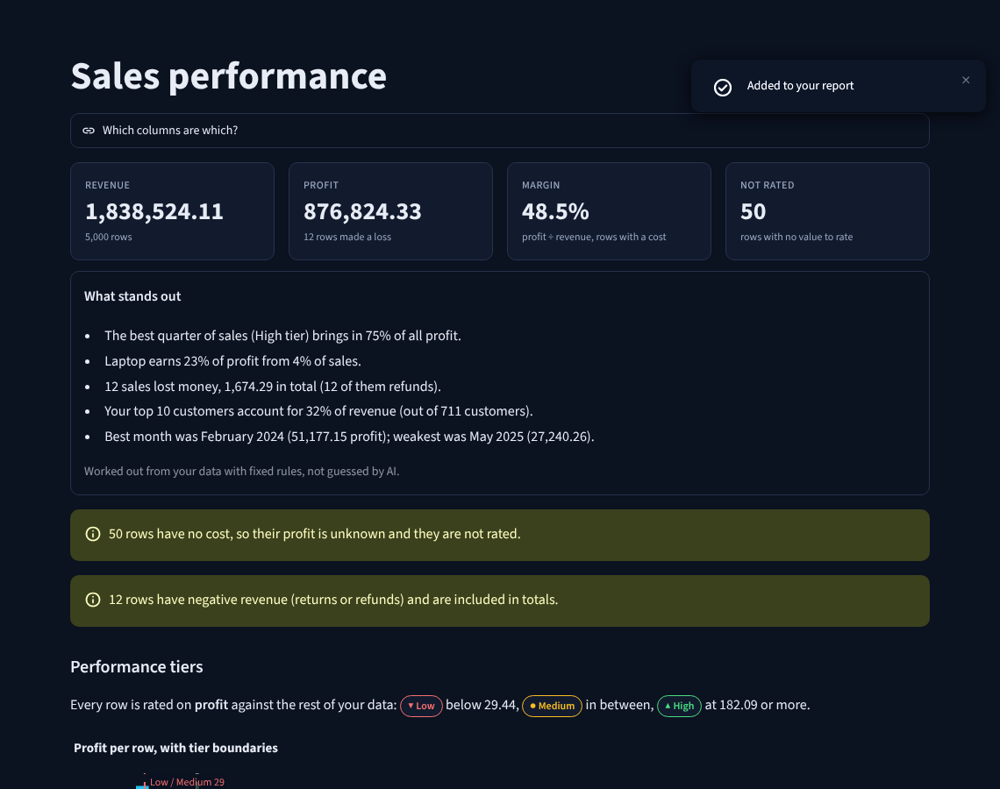
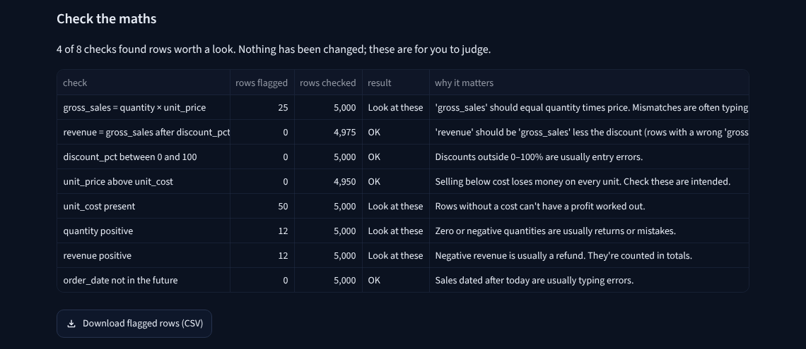

<p align="center"></p>

<h1 align="center">Truesum</h1>
<p align="center"><b>Your sales spreadsheet, explained in plain English.</b><br>
Truesum checks the maths, rates every sale on profit, and hands you back a workbook you can keep in Excel.</p>

<p align="center"><a href="#run-it-yourself">Run it yourself</a> · <a href="#how-it-works">How it works</a> · <a href="#whats-under-the-hood">Under the hood</a></p>



---

## The problem

Most small businesses keep their sales in a spreadsheet, and most people who use one aren't
Excel experts. Two complaints come up again and again in public reviews of Excel and Power BI
(92 comments read across six review sites and forums, 2011–2026):

- **Anything past the basics needs an expert.** Profit by product, the best customers, which
  sales lose money: the answers are in the file, but getting them out means formulas, pivot
  tables or a BI tool with a learning curve.
- **Mistakes are hard to spot.** A mistyped total or a missing cost quietly changes every number
  that depends on it, and nobody notices until the figures look odd.

## How it works

1. **Add your sales file**: CSV or Excel, up to 250,000 rows. Or try the built-in sample data.
2. **Clean it with one click**: tidy headers, merge `london`/`London`, remove duplicate rows,
   read dates. Every step is logged and can be undone. Missing numbers are left blank on purpose:
   a missing cost is never treated as free.
3. **Get answers**: each sale rated High, Medium or Low on profit against your own data, a short
   list of what stands out, charts, and downloads (Excel workbook, HTML report, CSV).

## What makes it different

| | |
| --- | --- |
| **Checks the maths** | Tests that gross = quantity × price, revenue = gross less discount, discounts sit between 0 and 100%, nothing is sold below cost or dated in the future. Flags the rows; changes nothing. |
| **Plain-English findings** | "Laptop earns 23% of profit from 4% of sales." Worked out with fixed rules from your data, not guessed by an AI model. |
| **Back to Excel** | One workbook with the summary, tiers, top performers, data checks and cleaning steps, so the answers live where you already work. |
| **Honest about limits** | Says what it couldn't work out (rows with no cost aren't rated) instead of filling the gap. |



## Run it yourself

```bash
git clone https://github.com/antonyatul/truesum.git
cd truesum
pip install -r requirements.txt
streamlit run app.py
```

Python 3.11 or newer. No accounts, keys or database: everything runs in memory for the
visit and nothing is saved.

## What's under the hood

- **Streamlit** front end; all logic in `truesum/core`, a plain Python package that never imports
  Streamlit, so it's unit-tested on its own and could sit behind an API later.
- **pandas 3** for cleaning and analysis, **Plotly** for charts (histograms are pre-binned so a
  250,000-row file still sends only a few KB to the browser), **openpyxl** for the workbook.
- **Performance, measured:** 200,000 distinct rows load, clean and analyse in about 2 seconds
  (330 MB peak).
- **Tests:** 100+ unit and page tests (pytest + Streamlit AppTest), a browser test of the whole
  flow at desktop and phone widths (Playwright), an automated accessibility scan (axe-core) with
  a keyboard-only run, and a row-level-security test for the planned accounts version. CI runs
  them on every push.
- **Accessible:** every colour pair meets WCAG AA; tiers use words and shapes, not colour alone.

### Project layout

```
app.py                 entry point and navigation
pages/                 one file per screen
truesum/core/          io, profile, cleaning, checks, sales, findings, customers, charts, report, workbook
truesum/ui/            theme tokens, shared components, session state
tests/                 unit/, app/, e2e/, db/
replica/               planning notes: recon, architecture, design, tests, research, brand, launch
```

## Where it came from

Truesum combines two earlier projects of mine: a Streamlit dashboard (upload, charts, HTML
report) and a command-line sales pipeline (cleaning, profit, performance tiers). Rebuilding
them as one app fixed a profit formula that ignored quantity (it overstated profit by about
73% on a 100,000-row test file) and a cleaning step that crashed on current pandas.

## Privacy

Files are read in memory on the server for your visit only. Truesum writes nothing to disk,
logs nothing about your data and keeps nothing after you leave. The host may keep its own standard logs. See the **Privacy & about** page in the app.

---

Built by **Atul Antony**, MSc IT with Data Analytics, University of the West of Scotland.
